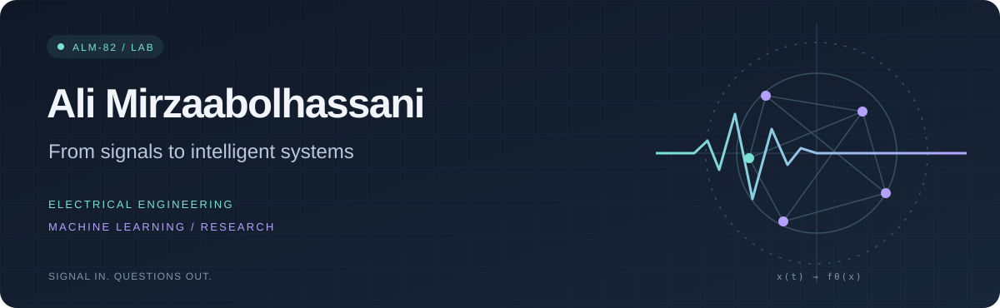
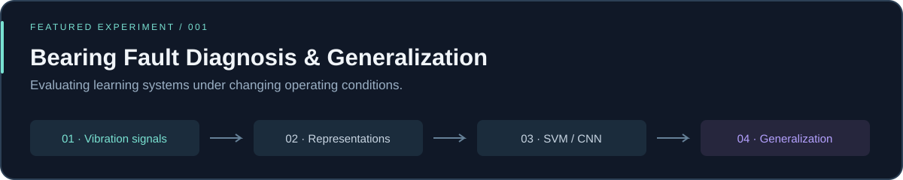

  

  
  

 

### `01 /` A little context

I'm **Ali**, an Electrical Engineering graduate with a Telecommunications background, exploring where **signals, machine learning, and intelligent systems** meet.

My undergraduate research started with vibration signals and bearing faults. It left me with a bigger question:

> **What happens when a model meets conditions it wasn't trained for?**

That's the direction I want to pursue through research-oriented Master's study in AI and Machine Learning.

 

### `02 /` On my research radar

**Robustness & generalization** / **Signal processing** / **Computer vision** / **Intelligent diagnostics**

Also curious about robotics and AI applications in healthcare.

 

### `03 /` Research spotlight

**Can a bearing-fault classifier generalize across operating loads and fault sizes?**

My undergraduate project explores this question through two approaches:

- **Feature-based:** vibration analysis → statistical features → SVM.
- **Deep learning:** STFT spectrograms → EfficientNet-B0 transfer learning.

FFT, Hilbert envelope analysis, confusion matrices, and error analysis connect the signal-processing and evaluation stages.

<b>Open the experiment notes ↗</b>

 

| Historical experiment | Classes | Test accuracy |
| :--- | :---: | ---: |
| Cross-load evaluation | 10 | **98.97%** |
| Cross-fault-size evaluation | 4 | **70.00%** |

These results come from separate protocols and are not a controlled comparison. The repository preserves historical evidence, notebooks, implementation details, and known methodological limitations. Original model checkpoints are unavailable, and full training has not been independently reproduced.

[Read the scientific audit →](https://github.com/alm-82/cwru-bearing-generalization/blob/main/docs/scientific_audit.md)

 

[**Repository ↗**](https://github.com/alm-82/cwru-bearing-generalization) &nbsp; / &nbsp; [**Notebooks ↗**](https://github.com/alm-82/cwru-bearing-generalization#start-with-the-notebooks) &nbsp; / &nbsp; [**Methods & limitations ↗**](https://github.com/alm-82/cwru-bearing-generalization/blob/main/docs/scientific_audit.md)

 

### `04 /` My toolkit

**Research & scientific computing**

NumPy · SciPy · pandas · Matplotlib · torchvision · Jupyter

**Building & shipping**

Practical experience through a web development internship, an independent full-stack note-taking app, and an educational AI workflow automation project.

 

---

  SIGNALS → REPRESENTATIONS → LEARNING → EVALUATION 
  <b>Interested in what happens beyond the training conditions.</b>  
  <a href="https://www.linkedin.com/in/ali-mirzaabolhassani-9ab2a3397/">Let's talk research ↗</a>

